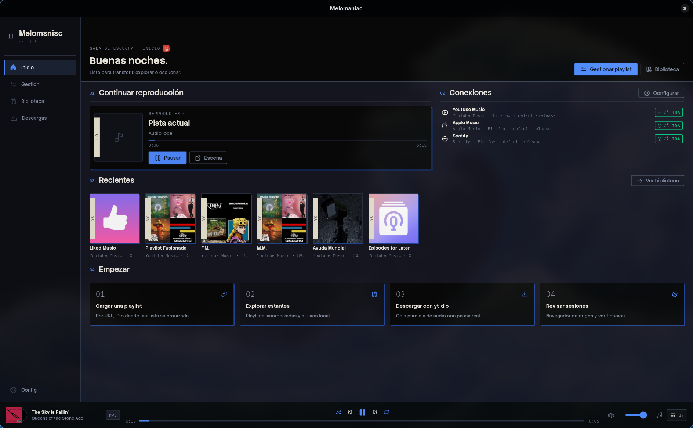
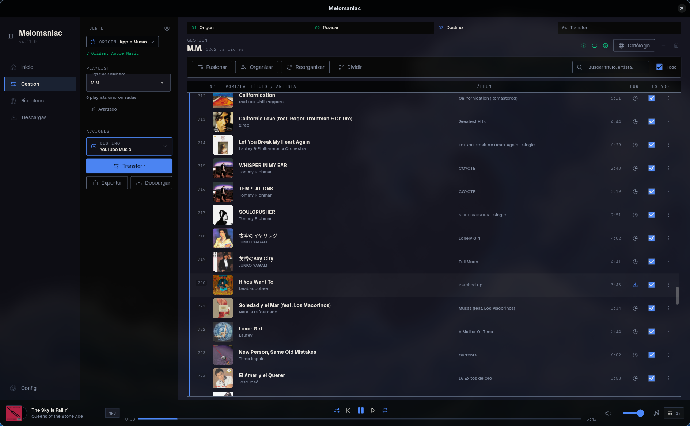
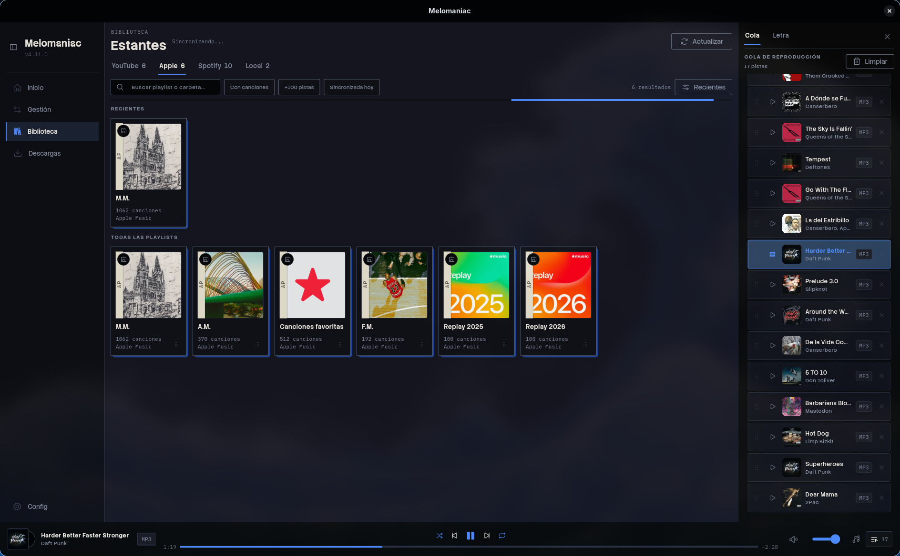
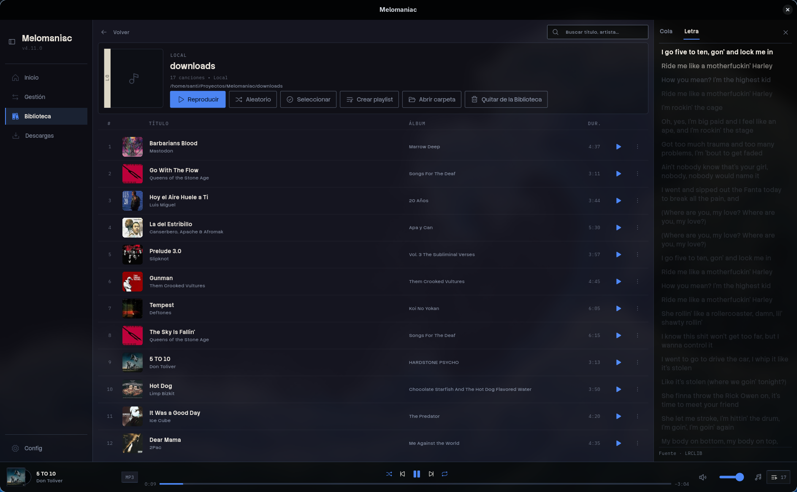
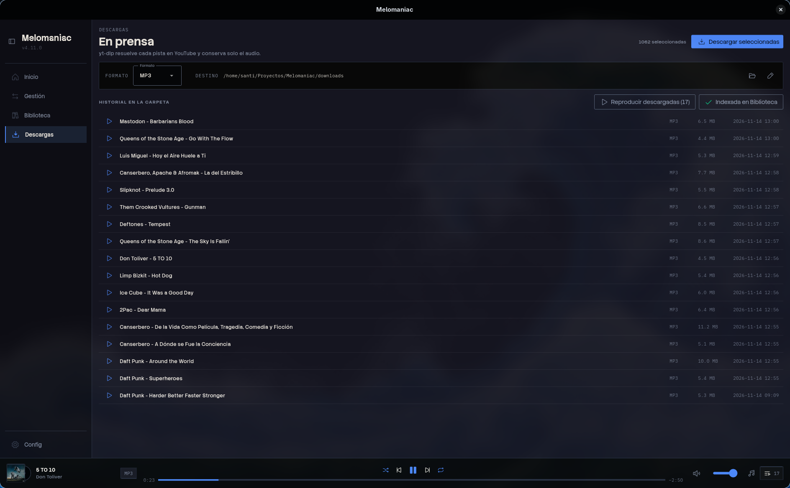
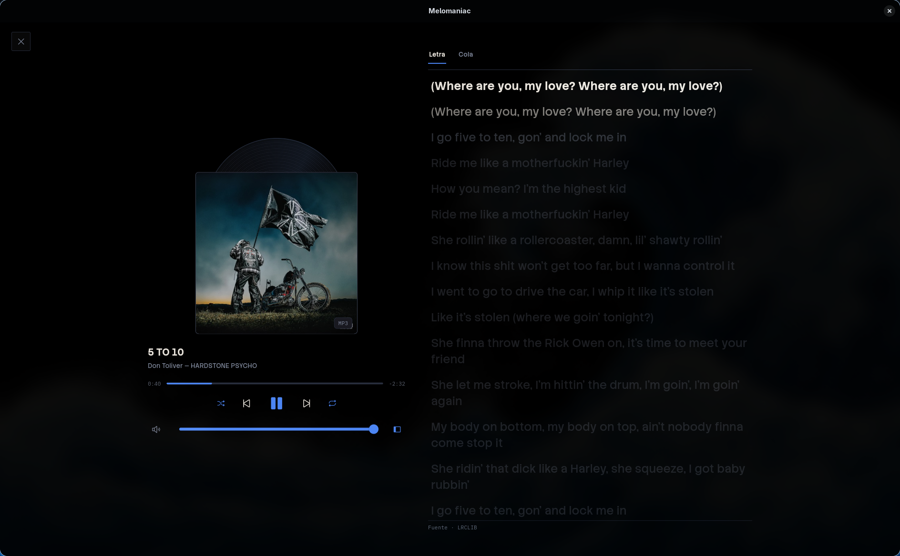

# 🎵 Melomaniac v4.11.1

[Español](README.md) · **English**

**Your music. Your library. Your way.**

[](https://www.python.org/)
[](https://flet.dev/)
[](https://github.com/rapidfuzz/RapidFuzz)
[](https://music.youtube.com/)
[](https://music.apple.com/)
[](https://open.spotify.com/)
[](LICENSE)

Desktop application to **transfer playlists between YouTube Music, Apple Music, and Spotify**, manage local music files, download audio for personal use, and play it in the app.

> Documentation: [Architecture](ARCHITECTURE.en.md) (flows, authentication, and internal details) · [Design](DESIGN.md) (visual tokens) · [Changes](CHANGELOG.md) · [Release Notes](RELEASE_NOTES.md)

---

## Features

- 🔄 **Cross-platform transfers** — Rebuild playlists between YouTube Music, Apple Music, and Spotify from a streaming playlist, a local file (`M3U/M3U8`, `PLS`, `WPL`, `XSPF`, `CSV`, `TXT`), an audio file, or pasted text.
- 🎯 **Matching engine** — Multi-stage matching with RapidFuzz, exact ISRC (Apple Music), duration, and explicit flags. Includes Cyrillic transliteration, query deduplication, and a Post-Mortem report to resolve ambiguous tracks.
- 🏠 **Home and Library** — Quick actions, playback resume, recent playlists, search, and filters. Brings together synced playlists, local folders, downloads, and imported manifests without audio.
- 🔎 **Catalog and playlist management** — Search songs, albums, and artists; merge sources, add tracks to playlists, transfer, and export from Management or the Library.
- 🎵 **Integrated player** — Global player bar, reorderable queue, shuffle/repeat, synchronized lyrics, MPRIS on Linux, and a Now Playing scene. Plays local files and remote tracks without downloading, with crossfade and resume of the last local track.
- ⬇️ **Downloads (personal use)** — Save audio with `yt-dlp` in MP3, M4A, Opus, FLAC, or WAV, with metadata, 800 px artwork, pause and resume of the track in progress, and one subfolder per playlist keeping its original order. Requires `ffmpeg`.
- 🔎 **Results panel** — When a batch finishes you see what was downloaded, what already existed, what failed, and what was missing; you can re-search the track on YouTube, pick another candidate, or retry in another format.
- 🛠️ **Organization and export** — List/Dual/Preview views, sorting and grouping by artist, album, or date, manual splits into 2–5 blocks, and export to `TXT`, `CSV`, `M3U/M3U8`, or `XSPF`.
- 🌐 **Browser session** — In most cases there is nothing to configure: it detects your active Firefox/Chromium session in memory. Manual credentials are available through the built-in wizard.
- 🖥️ **Settings and system integration** — Eight settings sections, release checks, persistent playlist and artwork caches. Packaged builds create and update the system shortcut.

## Screenshots

| Home | Management |
|---|---|
|  |  |

| Library | Playlist details and lyrics |
|---|---|
|  |  |

| Downloads | Now Playing |
|---|---|
|  |  |

## Roadmap

The documented version is **4.11.1**. Upcoming priorities:

- **Library and accessibility:** favorites, total duration on playlist cards, and remaining settings for scaling, density, and visible keyboard focus. A dedicated Search view will also be evaluated.
- **Recommendation foundations:** build favorites and listening history as signals for a persistent, broad, local music profile. It should recognize multiple taste clusters, limit the weight of recent activity, and distinguish curiosity from sustained preference.
- **Discover — primary focus:** build a recommendation algorithm that takes candidates and metadata from available sources, then ranks them for personal relevance. The MVP covers songs, artists, and albums, combining affinity, familiarity, diversity, and a configurable exploration level; popularity remains secondary, and each recommendation must have an explanation grounded in real signals. Genres and styles can follow later.
- **Other planned improvements:** separate activity and listening histories, statistics, a playlist workspace, and local metadata editing.

The profile should not treat a single play, a saved track, or an ignored recommendation as definitive proof of preference or rejection. The order is indicative; see the project roadmap notes for the full plan.

---

## Legal notice and license

- **MIT code:** Melomaniac is distributed under the MIT License (see [`LICENSE`](LICENSE)). The license covers the software, not any music content.
- **Personal use:** the Downloads feature is for strictly personal, non-commercial use. Do not distribute, sell, publish, or make downloaded audio available to third parties, and do not use it for commercial purposes.
- **No content hosting:** Melomaniac does not host, provide, or redistribute copyrighted music content.
- **User responsibility:** you are responsible for ensuring that any content you obtain, store, or use through Melomaniac is authorized, and for complying with the Terms of YouTube, YouTube Music, Apple Music, and Spotify, as well as applicable local law (including Colombian law: Ley 23 de 1982 and Ley 1915 de 2018).
- **No affiliation:** it is not affiliated with or endorsed by Google, YouTube, Apple, Spotify, or their licensors.
- **No warranty:** the software is provided "as is", without warranty of any kind; to the maximum extent permitted by law, the authors are not liable for damages arising from its use.

---

## Installation

### Standalone binaries (recommended)

Each GitHub release includes compiled packages that do not require Python; use them if you do not want to install from source:

| Package | File |
|---|---|
| Portable source bundle | `Melomaniac-vX.Y.Z.zip` |
| Linux | `Melomaniac-vX.Y.Z-x86_64.AppImage`, `Melomaniac-vX.Y.Z-linux-x64.tar.gz` |
| Windows | `Melomaniac-vX.Y.Z-windows-x64-Setup.exe`, `Melomaniac-vX.Y.Z-windows-x64.zip` |

The verifiable hash of each package is the SHA-256 `digest` GitHub shows per asset (no `.txt` hash files are published).

In the binaries, configuration is stored outside the install folder (`$XDG_CONFIG_HOME/melomaniac` on Linux, `%APPDATA%\Melomaniac` on Windows), unless portable mode is active (writable `config/` folder or `portable.flag`).

### From source

**Requirements:** Python 3.10+, `ffmpeg` 6+ on `PATH` (for Downloads), and the pinned dependencies in [`requirements.txt`](requirements.txt).

The launchers create the `.venv` environment, install dependencies on first run, and start the app:

- **Windows:** double-click `scripts\launchers\run.bat`.
- **Linux / macOS:** `./scripts/launchers/run.sh`

<details>
<summary><b>Manual step-by-step installation</b></summary>

```bash
git clone https://github.com/Brimx/Melomaniac.git
cd Melomaniac
python3 -m venv .venv
source .venv/bin/activate
pip install -r requirements.txt
python app.py
```

On Windows/PowerShell, if activation is blocked (`running scripts is disabled`), use `scripts\launchers\run.bat` or the direct path: `.\.venv\Scripts\python app.py`. On Ubuntu/Debian, if you see `ensurepip is not available`, install `sudo apt install python3-venv`.

</details>

### Updating

```bash
git pull
```

Start the app again with `scripts/launchers/run.bat`/`run.sh` (they detect `requirements.txt` changes and install dependencies automatically). `config/`, downloads, and caches are git-ignored and untouched. If `ffmpeg` is not detected in Downloads, restart your terminal so the new `PATH` is loaded.

---

## Usage

1. On the home screen, choose a source (a synced playlist from your library, local file, pasted text, or URL/ID under «Avanzado»).
2. Load the playlist (or search songs, albums, and artists from **Catalog**, or combine sources with **Merge**) and review the tracks; uncheck any you do not want.
3. Optionally: **Organize** (sort/group) or **Split** (manual blocks) from the contextual bar and switch between List, Dual, and Preview views.
4. Click **Transfer** (pick the destination and validate the session live in the dialog), **Download**, or **Export** to a file or target playlist. When finished, the Post-Mortem report lets you search for alternatives to ambiguous tracks.
5. Play local and downloaded files, or stream supported remote tracks without downloading, from the bottom bar (with side queue) or the Library.

The first run shows a guided welcome tour (reopenable from Config).

### Credentials and configuration

The session is resolved in memory from your browser (Firefox/Chromium). If you need manual credentials, the wizard (gear icon in the side rail) stores them in `config/`:

| File | Purpose |
|---|---|
| `config/browser.json` | YouTube Music: session cookies (`Cookie`); `SAPISIDHASH` is computed on each read |
| `config/.env` | Apple Music: `APPLE_AUTH_BEARER`, `APPLE_MUSIC_USER_TOKEN` |
| `config/spotify_cookies.json` | Spotify: `sp_dc`, `sp_key` |
| `config/settings.json` | Playback, download, Library, appearance, accessibility, and browser preferences |
| `config/search_cache.json` | Cached search results |
| `config/transfer_history.jsonl` | Transfer and resolution history |
| `config/library_playlists.json`, `config/local_index.json` | Local Library metadata and index |
| `config/playlist_cache/`, `config/cover_cache/`, `config/lyrics/` | Playlist, artwork, and lyrics caches |

Files in `config/` are equivalent to your session: never share or commit them.

---

## Verification

```bash
python -m compileall -q app.py core engine services ui scripts
python -m unittest discover -s tests -t .
```

The Flet UI is also validated manually on desktop (view modes, Organize/Split dialogs, responsive navigation, Library, and export). The `tests/` folder contains the unit and regression suites for engine, services, and UI controllers.

## Thanks

[Flet](https://flet.dev) · [ytmusicapi](https://github.com/sigma67/ytmusicapi) · [spotapi](https://github.com/spotapi) · [RapidFuzz](https://github.com/maxbachmann/RapidFuzz) · [Mutagen](https://mutagen.readthedocs.io/)
