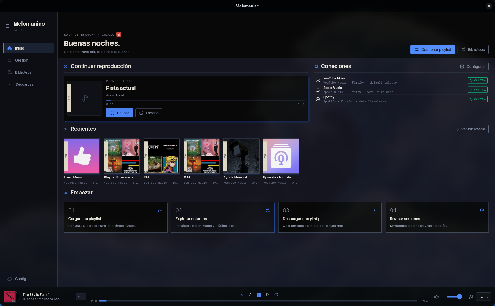
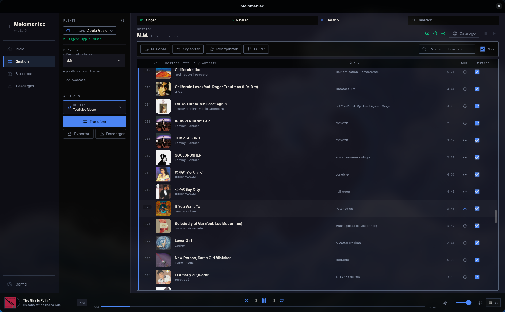
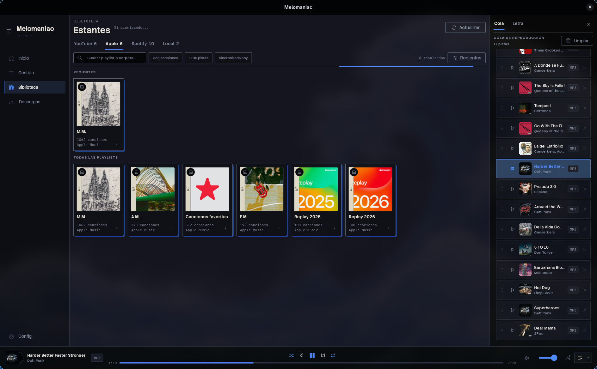
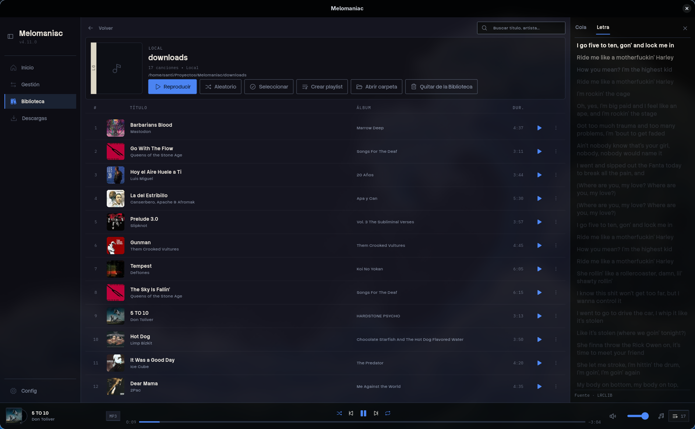
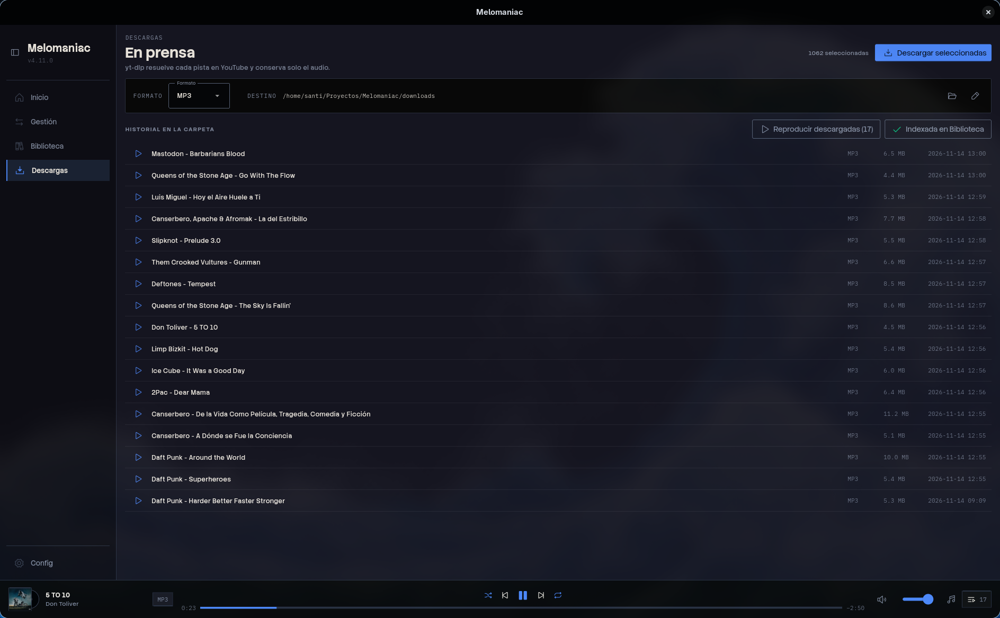
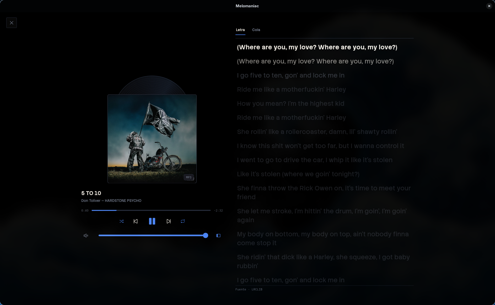

# 🎵 Melomaniac v4.11.1

**Español** · [English](README.en.md)

**Tu música. Tu librería. Tu elección.**

[](https://www.python.org/)
[](https://flet.dev/)
[](https://github.com/rapidfuzz/RapidFuzz)
[](https://music.youtube.com/)
[](https://music.apple.com/)
[](https://open.spotify.com/)
[](LICENSE)

Aplicación de escritorio para **transferir playlists entre YouTube Music, Apple Music y Spotify**, gestionar archivos locales de música, descargar audio para uso personal y reproducirlo en la propia app.

> Documentación: [Arquitectura](ARCHITECTURE.md) (flujos, autenticación y detalles internos) · [Diseño](DESIGN.md) (tokens visuales) · [Cambios](CHANGELOG.md) · [Notas de release](RELEASE_NOTES.md)

---

## Funcionalidades

- 🔄 **Transferencia entre plataformas** — Reconstruye listas entre YouTube Music, Apple Music y Spotify desde una playlist en streaming, un archivo local (`M3U/M3U8`, `PLS`, `WPL`, `XSPF`, `CSV`, `TXT`), un archivo de audio o texto pegado.
- 🎯 **Motor de coincidencia** — Matching multi-fase con RapidFuzz, ISRC exacto (Apple Music), duración y flag explícito. Incluye transliteración cirílica, deduplicación de consultas y reporte Post-Mortem para resolver pistas dudosas.
- 🏠 **Inicio y Biblioteca** — Accesos rápidos, reanudación de reproducción, playlists recientes, búsqueda y filtros. Reúne playlists sincronizadas, carpetas locales, descargas y manifiestos importados sin audio.
- 🔎 **Catálogo y gestión** — Busca canciones, álbumes y artistas; fusiona fuentes, añade pistas a playlists, transfiere y exporta desde Gestión o la Biblioteca.
- 🎵 **Reproductor integrado** — Barra global, cola reordenable, shuffle/repeat, letras sincronizadas, MPRIS en Linux y escena Reproduciendo. Reproduce archivos locales y pistas remotas sin descargarlas; incluye crossfade y reanudación de la última pista local.
- ⬇️ **Descargas (uso personal)** — Guarda audio con `yt-dlp` en MP3, M4A, Opus, FLAC o WAV, con metadatos, carátula a 800 px, pausa y reanudación de la pista en curso, y una subcarpeta por playlist con su orden original. Requiere `ffmpeg`.
- 🔎 **Panel de resultados** — Al terminar una descarga ves qué se descargó, qué ya existía, qué falló y qué faltó; puedes rebuscar la pista en YouTube, elegir otro candidato o reintentar en otro formato.
- 🛠️ **Organización y exportación** — Vistas Lista/Doble/Preview, ordenación y agrupación por artista, álbum o fecha, división manual en 2–5 bloques y exportación a `TXT`, `CSV`, `M3U/M3U8` o `XSPF`.
- 🌐 **Sesión desde el navegador** — En la mayoría de los casos no hay nada que configurar: detecta tu sesión activa de Firefox/Chromium en memoria. Credenciales manuales disponibles vía asistente integrado.
- 🖥️ **Configuración e integración** — Ocho secciones de ajustes, comprobación de nuevas releases, caché persistente de playlists y portadas. En binarios crea y actualiza el acceso directo del sistema.

## Capturas

| Inicio | Gestión |
|---|---|
|  |  |

| Biblioteca | Detalle de playlist y letras |
|---|---|
|  |  |

| Descargas | Reproduciendo |
|---|---|
|  |  |

## Roadmap

La versión documentada es **4.11.1**. Las próximas prioridades son:

- **Biblioteca y accesibilidad:** favoritos, duración total en las tarjetas y ajustes pendientes de escala, densidad y foco de teclado. También se evaluará una vista dedicada de Buscar.
- **Fundamentos de recomendación:** crear favoritos e historial de escucha como señales para un perfil musical persistente, amplio y local. Debe reconocer varios grupos de gustos, dar peso limitado a la actividad reciente y distinguir la curiosidad de una preferencia sostenida.
- **Discover — prioridad principal:** construir un algoritmo propio que reciba candidatos y metadatos de las fuentes disponibles, y los ordene según la afinidad personal. El MVP cubrirá canciones, artistas y álbumes, combinando afinidad, familiaridad, diversidad y un nivel configurable de exploración; la popularidad será secundaria y cada recomendación tendrá una explicación respaldada por señales reales. Géneros y estilos podrán añadirse después.
- **Otras mejoras previstas:** historial separado de actividad y escucha, estadísticas, workspace de playlists y edición de metadatos locales.

El perfil no debe tratar una reproducción aislada, una canción guardada o una recomendación ignorada como prueba definitiva de gusto o rechazo. El orden es orientativo; el roadmap detallado está en las notas de producto del proyecto.

---

## Aviso legal y licencia

- **Código MIT:** Melomaniac se distribuye bajo licencia MIT (ver [`LICENSE`](LICENSE)). La licencia cubre el software, no los contenidos musicales.
- **Uso personal:** la función de Descargas es solo para uso estrictamente personal y sin fines comerciales. No distribuyas, vendas, publiques ni pongas a disposición de terceros el audio descargado, ni lo uses con fines comerciales.
- **Sin alojamiento de contenido:** Melomaniac no aloja, proporciona ni redistribuye contenido musical protegido por derechos de autor.
- **Responsabilidad del usuario:** eres responsable de que cualquier contenido que obtengas, almacenes o utilices mediante Melomaniac esté autorizado, y de cumplir los términos de YouTube, YouTube Music, Apple Music y Spotify, así como la legislación local aplicable (incluida la colombiana: Ley 23 de 1982 y Ley 1915 de 2018).
- **Sin afiliación:** no está afiliado ni respaldado por Google, YouTube, Apple, Spotify ni sus titulares de licencia.
- **Sin garantía:** el software se proporciona «tal cual», sin garantía expresa o implícita; en la máxima medida permitida por la ley, los autores no responden por daños derivados de su uso.

---

## Instalación

### Binarios standalone (recomendado)

Cada release en GitHub incluye paquetes compilados que no requieren Python; úsalos si no quieres instalar desde código:

| Paquete | Archivo |
|---|---|
| Código fuente portátil | `Melomaniac-vX.Y.Z.zip` |
| Linux | `Melomaniac-vX.Y.Z-x86_64.AppImage`, `Melomaniac-vX.Y.Z-linux-x64.tar.gz` |
| Windows | `Melomaniac-vX.Y.Z-windows-x64-Setup.exe`, `Melomaniac-vX.Y.Z-windows-x64.zip` |

El hash verificable de cada paquete es el `digest` SHA-256 que GitHub muestra por asset (no se publican archivos `.txt` de hashes).

En los binarios, la configuración se guarda fuera de la carpeta de instalación (`$XDG_CONFIG_HOME/melomaniac` en Linux, `%APPDATA%\Melomaniac` en Windows), salvo modo portable (carpeta `config/` escribible o `portable.flag`).

### Desde el código

**Requisitos:** Python 3.10+, `ffmpeg` 6+ en el `PATH` (para Descargas) y las dependencias fijadas en [`requirements.txt`](requirements.txt).

Los lanzadores automáticos crean el entorno `.venv`, instalan dependencias en el primer arranque y ejecutan la app:

- **Windows:** doble clic en `scripts\launchers\run.bat`.
- **Linux / macOS:** `./scripts/launchers/run.sh`

<details>
<summary><b>Instalación manual paso a paso</b></summary>

```bash
git clone https://github.com/Brimx/Melomaniac.git
cd Melomaniac
python3 -m venv .venv
source .venv/bin/activate
pip install -r requirements.txt
python app.py
```

Con [`uv`](https://docs.astral.sh/uv/) (más rápido, mismo resultado): `uv venv` y `uv pip install -r requirements.txt`; `requirements.txt` sigue siendo la fuente única, así que `uv pip sync` **no** se usa (el archivo no es un volcado completo: `flet-cli` arrastra `pyinstaller`, `flet-web` u otros que no están listados).

En Windows/PowerShell, si la activación está bloqueada (`running scripts is disabled`), usa `scripts\launchers\run.bat` o la ruta directa: `.\.venv\Scripts\python app.py`. En Ubuntu/Debian, si aparece `ensurepip is not available`, instala `sudo apt install python3-venv`.

</details>

### Actualización

```bash
git pull
```

Vuelve a arrancar con `scripts/launchers/run.bat`/`run.sh` (detectan cambios en `requirements.txt` e instalan dependencias automáticamente). `config/`, descargas y cachés están ignorados por Git y no se tocan. Si `ffmpeg` no se detecta en Descargas, reinicia la terminal para que cargue el nuevo `PATH`.

---

## Uso

1. En la pantalla inicial elige el origen (plataforma sincronizada de tu biblioteca, archivo local, texto pegado o URL/ID bajo «Avanzado»).
2. Carga la playlist (o busca canciones, álbumes y artistas desde **Catálogo**, o combina fuentes con **Fusionar**) y revisa las pistas; desmarca las que no quieras.
3. Opcional: **Organizar** (ordenar/agrupar) o **Dividir** (bloques manuales) desde la barra contextual y alterna entre vistas Lista, Doble y Preview.
4. Pulsa **Transferir** (elige el destino y valida la sesión en vivo en el mismo diálogo), **Descargar** o **Exportar** a archivo o a una playlist destino. Al terminar, el reporte Post-Mortem permite buscar alternativas para las pistas dudosas.
5. Reproduce archivos locales y descargados, o transmite pistas remotas compatibles sin descargarlas, desde la barra inferior (con cola lateral) o desde Biblioteca.

La primera ejecución muestra una bienvenida guiada (reabrible desde Config).

### Credenciales y configuración

La sesión se resuelve en memoria desde tu navegador (Firefox/Chromium). Si necesitas credenciales manuales, el asistente (icono de engranaje del rail lateral) las guarda en `config/`:

| Archivo | Uso |
|---|---|
| `config/browser.json` | YouTube Music: cookies de sesión (`Cookie`); `SAPISIDHASH` se calcula en cada lectura |
| `config/.env` | Apple Music: `APPLE_AUTH_BEARER`, `APPLE_MUSIC_USER_TOKEN` |
| `config/spotify_cookies.json` | Spotify: `sp_dc`, `sp_key` |
| `config/settings.json` | Preferencias de reproducción, descargas, Biblioteca, apariencia, accesibilidad y navegador |
| `config/search_cache.json` | Caché de búsquedas previas |
| `config/transfer_history.jsonl` | Historial de transferencias y resoluciones |
| `config/library_playlists.json`, `config/local_index.json` | Metadatos e índice de la Biblioteca local |
| `config/playlist_cache/`, `config/cover_cache/`, `config/lyrics/` | Cachés de playlists, portadas y letras |

Los archivos de `config/` equivalen a tu sesión: no los compartas ni los subas a Git.

---

## Verificación

```bash
python -m compileall -q app.py core engine services ui scripts
python -m unittest discover -s tests -t .
```

La UI de Flet se valida también manualmente en escritorio (modos de vista, diálogos Organizar/Dividir, navegación responsive, Biblioteca y exportación). La carpeta `tests/` reúne las pruebas unitarias y de regresión del motor, servicios y controladores UI.

## Agradecimientos

[Flet](https://flet.dev) · [ytmusicapi](https://github.com/sigma67/ytmusicapi) · [spotapi](https://github.com/spotapi) · [RapidFuzz](https://github.com/maxbachmann/RapidFuzz) · [Mutagen](https://mutagen.readthedocs.io/)
